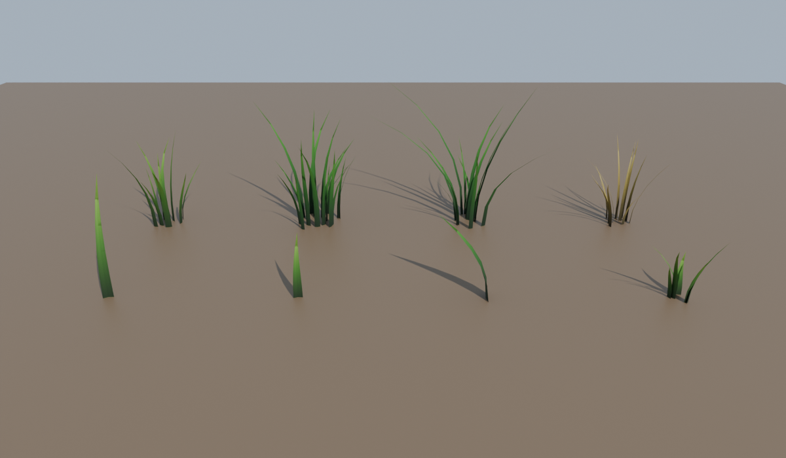

# Grass pack for Roblox (grounded style)

Eight low-poly grass meshes modelled in Blender, plus a Studio plugin to paint them onto terrain.

| Mesh | Tris | Approx. height (studs) |
|---|---|---|
| Grass_Blade_Tall | 36 | 2.4 |
| Grass_Blade_Short | 36 | 1.3 |
| Grass_Blade_Wide | 36 | 1.8 |
| Grass_Tuft_Small | 216 | 1.5 |
| Grass_Tuft_Medium | 396 | 2.5 |
| Grass_Tuft_Large | 648 | 3.0 |
| Grass_Tuft_Wild | 504 | 3.5 |
| Grass_Tuft_Dry (yellow) | 432 | 2.3 |

Every blade is double-sided, because Roblox hides the back faces of a mesh. Blades are tapered, creased down the middle and curved. The UVs run from root to tip, so each 64×256 texture fades from dark roots to lighter tips. Each mesh's pivot is its root, at the bottom of the mesh.

## Files
- `export/GrassPack.fbx`: all eight meshes in one file (textures embedded). **Import this one.**
- `export/Grass_*.fbx`: each mesh on its own, if you only want some.
- `export/GrassPack.glb`: the same pack as glTF.
- `export/textures/`: the three blade textures (green, lush, dry).
- `blender/grass_pack.blend`: the Blender scene, for editing.
- `blender/make_grass.py`: the script that builds and exports everything. Change the numbers in `variants` (blade count, height, lean, width), then run `blender --background --python make_grass.py`.
- `studio/GrassPainter.lua`: the Roblox Studio plugin for placing the grass.

## 1. Import into Roblox Studio
1. Open your place. Go to the **Home** tab (or **File**), choose **Import 3D**, and select `export/GrassPack.fbx`.
2. In the importer, open the **File General** settings and set **Scale Unit** to **Stud**. The meshes are modelled in studs, so a medium tuft is about 2.5 studs tall.
3. Click **Import**. Studio uploads the meshes and textures to your account and creates a Model called `GrassPack` with 8 MeshParts.
4. Drag that model into **ServerStorage** and keep the name `GrassPack`.

At this point you can already place grass by hand: copy a MeshPart out of `GrassPack` and paste it into Workspace. For whole fields, use the plugin below.

## 2. Install the Grass Painter plugin
1. In Studio, go to the **Plugins** tab, click **Plugins Folder**, and copy `studio/GrassPainter.lua` into it.
2. Restart Studio. A **Grass** toolbar with a **Grass Painter** button appears.

## 3. Paint
- Click **Grass Painter**. A panel opens and a green circle follows your mouse.
- **Click or drag** on Terrain or Parts to scatter random tufts, with random rotation and scale. They follow slopes.
- **Ctrl + drag** erases grass (the circle turns red).
- **[** and **]** make the brush smaller or larger.
- The panel sets brush radius, tufts per dab, minimum spacing, scale range, how deep the roots sink, align to slope, shadows, and which variants are used. For example, switch off everything except `Grass_Tuft_Dry` to paint dry patches.
- Each stroke is one undo step (Ctrl+Z).

Painted grass goes into `Workspace.Grass`. Each tuft is anchored with CanCollide, CanTouch and CanQuery turned off, so players walk through it and it doesn't block raycasts. Shadows are off by default, which keeps big fields cheap. Turn **Cast shadows** on in the panel if you want them on hero patches.

## Tips for a grounded look
- Mix variants: mostly Medium and Small tufts, a few Large and Wild ones, and Dry patches near paths and rocks.
- To tint a tuft, change its `Color` in Properties. It multiplies with the texture, so slightly yellow or blue greens add variety.
- On big maps, paint dense grass only where players actually walk, and use the Terrain Grass material elsewhere.
